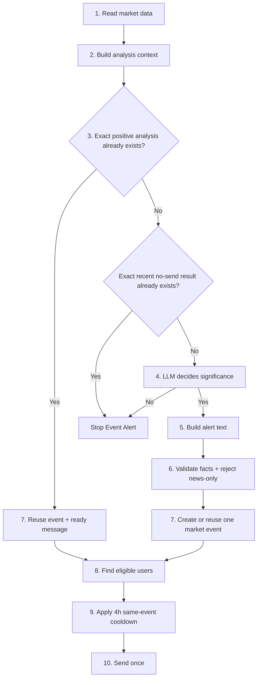

# Event Alert logic

Current flow, in simple form.



## Step 1 - Read the market
BTC, ETH, GRAM, and SOL are checked on the automatic schedule. Detection runs even when nobody is
currently eligible to receive that coin.

## Step 2 - Build the evidence
The bot prepares current price, recent snapshots, compact 30m/1h moves when reliable,
analysed-window and 24h moves, movement since the last message, 30-day relative-move context,
previous Event Alert context, recent 6h/24h alert-worthy market-event counts, and relevant news.

Numbers are evidence only. No backend numeric threshold decides whether an Event Alert is important.

## Step 3 - Reuse only exact previous work
Before new LLM calls, the bot checks whether this exact canonical context was already handled.

Two cases:
- an existing positive Event Analysis already has its event and rendered message -> reuse it and go
  straight to recipient checks;
- an exact recent context already ended with no alert / no delivery -> record the reuse and stop.

The exact-context fingerprint preserves the priority order of the first two
valid news items seen by the significance model. It does not sort headlines:
changing their order may change the model-visible evidence and must
invalidate cache reuse.

No rounding buckets or movement tolerances are used.

## Step 4 - Decide significance
If nothing can be reused, the significance LLM returns schema-validated `should_alert`, confidence,
`materiality`, `novelty`, and reason. Its default is no alert.

The model must judge these in order:

1. **Materiality** — is the current market move itself materially noteworthy for this asset?
2. **Novelty** — if material, is it materially new versus recent Event Alerts and recent
   alert-worthy market events?
3. **Reason** — only then classify the positive pattern.

The 24h move, news, previous alerts, and recent-event counts are context. They do not make an
otherwise routine current move material. Previous alerts and recent-event counts can reduce novelty
but cannot increase materiality. A small counter-move against a larger 24h trend is not, by itself,
a meaningful reversal. Likewise, a move is not a `fast_move` merely because one short window is
faster than another; the current move itself must be materially noteworthy for the asset.

There is still no deterministic numeric threshold in the backend. Percentages and historical
percentiles are evidence for the LLM, not hard gates.

- `should_alert=true` is schema-valid only with `materiality=material` and `novelty=new`;
- otherwise the result must be `should_alert=false`;
- news-only -> false;
- contradictory field combinations are schema-invalid and do not proceed to render or delivery.

Alert reasons (`unusual_move`, `fast_move`, `reversal`, `trend_acceleration`,
`market_news_alignment`) are valid only with a positive decision. No-alert reasons
(`routine_move`, `news_only`, `unclear`) are valid only with a negative decision.

### Significance prompt selection — CCW-47 (2026-10-26)

The owner selected **the exact original Refined v2** for Stage-1 Event Significance,
not the shorter Refined v2 Final. In the isolated paid GPT-6 Luna replay, the
original produced 200/200 valid responses; the revised shorter prompt had 14/200
schema failures, with improved conditional recall but 15 vs 8 false positives
on differently sized valid subsets of owner-labelled disagreements. Keeping
the original prioritises low noise and reliable structured outputs. This exact
prompt was included in the `main` source by PR #378; live deployment and
model quality require separate verification.

The original instructions are frozen at
`reports/event-alert-review-20261016/ccw29_private/fresh200_unseen/candidate_refined.txt`
(instruction SHA-256 `e30183660bffd977bc81a5a8f19093a07e9267a3da12aa12e9bbac913ed3f07c`).
The shorter rejected trial remains in `benchmarks/event-alert-owner-20261026/`
for experiment provenance only. See
[`CCW47_REFINED_V2_DECISION_20261026.md`](../reports/event-alert-review-20261016/CCW47_REFINED_V2_DECISION_20261026.md)
for the metrics, denominator caveats and evaluation limits. Actual Groq/Cloudflare
significance quality still needs measured live evaluation.

## Step 5 - Render the accepted event (owner decision, 2026-10-30)

**Preserve-first contract:** Stage-1 owns significance, novelty and the decision to alert.
A positive market event receives **one shared** Stage-2 render operation through the existing
configured provider chain; never render separately per recipient. Stage-2 returns structured
Situation (`message_body`), Possible action and optional `related_news_ids`.

The verified Stage-2 text is the final Telegram copy. The backend must not replace or compact
valid sentences on word count, sentence count, style, descriptive detail, conditional
scenarios, price trajectory, acceleration, divergence, prior-event comparisons, or use of
trading-related words. There is **no 28/48-word Situation cap** or 60-word action cap in the
Event Alert presentation path. Backend performs only structure/symbol checks, factual
grounding against the actual market snapshots/prices/percentages/time windows, checks for
unsupported causality/certainty, news-ID validation, missing or mixed sections, and safe
Telegram normalization/HTML escaping. Do not silently truncate prose.

The headline and metric block remain deterministic and show the observed market numbers.
Prompt Stage-2 to explain meaning and path rather than restating their exact numbers.
Verbatim metric redundancy may be rejected with a useful internal reason; valid
interpretation referencing the same time window must survive. Numeric prices quoted
by the model must correspond to actual supplied observations, at quoted precision.
An observed price band may guide scenarios but never mandates two high/low conditions.
Trading terminology (buy, sell, hold, entry, exit, exposure and risk management) is
permitted **in Stage-2 presentation fields**, superseding older no-trading-language
restrictions. This does not alter other product features. No guaranteed outcomes or
invented technical support/resistance, causes or forecasts are permitted.

The existing provider chain may repair invalid schema/facts within its configured
attempt limits. When no valid Render output is available, mark the render/analysis
failed with a privacy-safe reason. **Never** substitute deterministic Situation
or Possible action paragraphs; never change Stage-1 significance or invent an
outgoing alert. The final `Not financial advice.` footer is mandatory. When the
actual Telegram API message limit prevents safe delivery, reject safely rather
than silently trimming or duplicating a send.

### Related news pipeline

News is **optional supporting context** for a market-based Event Alert, never an
independent significance trigger. The full path is RSS ingestion, news intelligence,
PostgreSQL persistence, substantive relevance, incident-aware deduplication, ranking,
candidate shortlist, Stage-1/Stage-2 evidence, selected IDs, final relevance check
and Telegram delivery.

- Direct symbol relevance requires article-text evidence; a DB symbol tag alone
  is insufficient. Major, substantiated exchange breaches, liquidity failures,
  insolvencies, liquidations or other systemic crypto-market incidents may be
  market-wide evidence for BTC, ETH, SOL and GRAM even if not each coin is named.
  A generic exchange, ETF, regulatory, security or macro keyword is not enough.
- Rank by incident impact, article specificity, relevance and freshness. Material
  market-wide news can outrank routine directly tagged reports.
- The configurable `EVENT_ALERT_NEWS_SHORTLIST_LIMIT` defaults to six candidates,
  bounded at eight. Ranked, ordered candidates and their evidence are included in
  exact-context identity; order changes invalidate reuse. Stage-1 retains its
  smaller, fixed market-first significance context and unchanged decision policy.
- Group repeat reports of the same incident but retain materially different
  developments, including breach confirmation, losses, market reaction,
  attacker attribution, liquidity issues, and recovery.
- News-intelligence consumes only the configured per-run and hourly budget.
  Major incidents are prioritized. Budget-skipped stories remain visible for
  later classification and may be considered as explicitly unclassified headline
  evidence when substantive systemic scope is clear. Do not fabricate LLM
  classifications or pay for additional provider calls.
- Stage-2 may choose zero news IDs if none genuinely supports the event. Selected
  IDs must be distinct and belong to the presented candidate set. Final relevance
  is checked using the same substantive article-text evidence, not only tags.
  Do not assert that related news caused the price movement without evidence.

Log value-free render rejection reasons, selection counts, high-impact budget skips,
chosen IDs in bounded/sanitized form and final attachment counts. Never log prompts,
private Telegram content, raw news exports, or credentials. The October 29-30
Binance incident export motivates synthetic regression tests; raw exports must
not be versioned.

## Telegram Event Alert presentation (2026-10)

The market significance decision, one shared render per event, cooldowns, eligibility and
Market Heartbeat are unchanged. The nine display positions are: coin/Event Alert and
analysed-window percent, `Price (now)`, since *recipient's last successfully delivered*
notification when comparable price and delivery time are persisted, actual analysed-window
move, available historical-price chart, Situation, attributed Related context (always visible: linked headlines or the neutral text
`No relevant news linked to this market move.`), conditional Possible action, and
`Not financial advice.`

Rich Messages are supported by Telegram Bot API 10.2+ using `sendRichMessage` and
`InputRichMessage.media` for an inline PNG. The pinned `python-telegram-bot 22.8`
does not expose the rich-message API, so a small direct HTTPX adapter uses the official
endpoint. The outgoing message has one Telegram identity (not a chart message plus
caption). PNG creation reads existing timestamped PostgreSQL price snapshots once per
market event, never in the recipient loop, and caches the returned Telegram photo
`file_id` within that dispatch. No new market-data calls are made.

Only proven historical observations are plotted. Prefer the latest contiguous
run within the available 24 hours: at the standard 30-minute snapshot cadence,
a gap over 45 minutes starts a new run. Draw a connected line only within that
run, never across unobserved gaps or with invented/extrapolated prices. A
partial run with at least five observed points spanning two hours is a valid
shorter chart, labeled with its **actual observed duration** rather than "24h".
The latest point must be no older than 45 minutes (30m cadence plus 15m
scheduler/processing grace); older or insufficient data shows an explicit
unavailable explanation. The "Last 24 hours" label requires the selected run
to cover both rolling-window edges within 45 minutes. Full-day chart axes
show the true rolling 24-hour boundaries with blank unsampled edges; shorter
charts use first/last observed timestamps. This requires no new market-data
requests and preserves one shared chart per event or heartbeat.
Rich Event Alert and Heartbeat headings must reuse the configured Telegram
Custom Emoji for each coin, not the colored fallback placeholders.
Ordinary HTML and plain text remain fallbacks after *definitive* rejection of a richer
variant. Unknown transport acceptance must not trigger a second send because Telegram
has no caller-supplied send-idempotency key. Rich-client compatibility cannot be
reliably detected server-side; clients that do not render Rich Messages may require
updating Telegram. Any rollback should revert the presentation commit(s) and retain
existing event/delivery persistence; no schema migration is introduced.

### Rich notification layout follow-up (2026-10-17)

Event Alerts now use a deterministic coin icon, accented metric lines, clearly identified
Situation/Related context/Possible action sections and a chart heading in the same native
rich message. This is presentation only. The existing recipient-specific previous-message
comparison is recomputed for the final rich delivery; it must never leak another recipient's
comparison or duplicate its previous-message line.

Market Heartbeat also uses this rich layout with a persisted-price chart and styled HTML/
plain fallbacks. Its price chart is generated at most once per due symbol dispatch, before
iterating recipients; returned Telegram media IDs may be reused for that dispatch. No extra
price-provider or LLM calls are introduced per recipient. Missing chart evidence is stated
explicitly. Rich transport failures retain the existing definitive-rejection fallback and
uncertain-acceptance no-duplicate policy.

The 24-hour Heartbeat silence criterion, eligibility, idempotency, existing LLM output,
market significance decisions, semantic cooldown, recipients and billing are unchanged.
Production client appearance still needs a private Telegram Desktop/mobile smoke test;
mock images and CI-only HTML assertions do not prove native client rendering.

### Event Alert 24h metric and title (2026-10-29)

Show the separately sourced verified `24h market move` immediately after the
actual analysed-window move for every Event Alert (in rich, HTML and plain
versions). Omit it if the 24-hour change is unavailable; never call it an
analysed-window result, and never fabricate a missing value. The title uses
`BTC Event Alert: -1.12%` rather than an em dash followed by a minus sign.
Per-recipient comparison insertion cannot change the shared 24-hour metric.
The Market Heartbeat formatting remains unchanged.

### Event Alert chart reference markers (2026-10-26)

Event Alert PNGs (not Market Heartbeat PNGs) overlay four separate market
reference observations. The historical curve still contains only the latest
contiguous PostgreSQL price-snapshot run. The observed NOW marker extends the
line from its last persisted observation only if its actual timestamp is newer
and no more than 45 minutes later. Never invent a persisted snapshot or join
across a missing interval; NOW remains an independent, explicitly labelled event
observation.

- **NOW**: current Event Alert market price from the validated event input
  (stored in the event numeric context) at the actual price-check timestamp.
  It is never replaced by the newest persisted snapshot.
- **PREVIOUS ALERT**: latest *different* recorded market-level Event Alert for
  the same coin in `market_events`, using its own `detected_at` and `price`.
  It is not the previous per-recipient delivered notification. Historical
  events outside the visible chart have a time/status legend entry, but no
  boundary marker. Missing/unreliable prices produce no price marker.
- **−3H**: closest actually recorded snapshot in the visible continuous series
  to the exact current-observation minus three hours, only within **±20 min**.
  This reference is independent of the LLM's actual analysed-window length.
- **−24H**: closest actually recorded snapshot in the visible continuous
  series to the exact current-observation minus 24 hours, only within
  **±40 min** (normal 30-minute persistence plus scheduling jitter).
  The plotted point is at its *actual* UTC timestamp.

Every available reference shows its actual UTC timestamp and observed price
in the PNG legend, not an interpolated/extrapolated price. Unavailable
references show why the price marker was omitted. Colors, shapes, leader lines
and nonoverlapping label lanes keep dense/end-of-axis events readable. The
original full-day/partial-history labels and availability rules still apply.
There are no new external price calls, recipient-specific PNGs or database
migrations. Rich delivery, HTML/plain fallback, event decisions and Heartbeat
are unchanged. The marker overlay can be rolled back as a presentation-only
change.

## Step 6 - Validate the message
The backend validates schema and factual market claims. News may support the explanation, but a
standalone news-only Event Alert is rejected.

## Step 7 - Keep one event and one analysis
A newly detected event is created once. A reusable positive event keeps its already existing Event
Analysis and message.

Semantic event identity cannot be classified as `news_catalyst` from model wording alone: it
requires selected material related news. If an otherwise accepted market alert uses the bare
`{symbol}_news_catalyst` key without that evidence or a clear price family, the backend gives
it the neutral `{symbol}_market_event` identity. This changes identity classification, not the
LLM's significance decision or the market-first rule.

For an explicitly directional price family, the sign of the verified analysed-window move
wins over conflicting model key/title/body wording about a broader trend. A missing or flat
primary move does not invent direction. During recipient cooldown, an older stored directional
family is interpreted using its own saved analysed-window move when available, so correcting
an identity cannot restart the same event-family's strict four-hour window. When
either the current or a prior numeric directional price key lacks a stored semantic family,
the recipient cooldown derives that price family from the key before comparing identities.

Core rule:

```text
1 coin market event = 1 AI analysis = many deliveries
```

LLM calls never run inside the recipient loop.

## Step 8 - Find eligible users
Only now the bot checks delivery eligibility:
- coin enabled in watchlist;
- BTC is free;
- ETH, GRAM, and SOL require active Premium or trial;
- valid Telegram destination;
- duplicate chat IDs filtered.

The Market Heartbeat silence window does not decide Event Alert eligibility. Successfully
delivered Event Alerts reset the heartbeat clock for that recipient and coin; see
`docs/project_context.md`.

## Step 9 - Block repeats for 4 hours
For each recipient, the same canonical event key or the same semantic family is blocked for four
hours.

No bypass exists for a bigger move, urgency, new news, or a direction change inside the same
semantic event. A genuinely different semantic event can pass.

The four-hour semantic cooldown starts at **successful delivery**
(`sent_at`), using `created_at` only for legacy successful deliveries
without completion timestamps. Legacy events with missing identity may
recover the stored directional family from verified price movement.
An in-lock per-recipient same-family check protects against another event
being delivered between the bulk eligibility pass and actual sending.
Distinct price directions remain eligible. These are safety checks;
they do not introduce a percentage threshold.

## Step 10 - Send once
Delivery is idempotent. The bot records delivered, failed, filtered, cooldown, and suppression
outcomes and avoids sending the same event twice to the same recipient.

CoinGecko values keep full precision through analysis. Rounding is only for user-facing text.


Evaluation harness, documented baseline and reviewer procedure: [event_alert_benchmark.md](event_alert_benchmark.md).

## Event Alert acceptance criteria (approved 2026-10-16)

These are **product release acceptance criteria**, not runtime significance thresholds.
They apply to work intended to improve Event Alert usefulness. They do not change
the market-first policy, LLM significance authority, the four-hour semantic
cooldown, or the shared-analysis architecture.

### Independent evidence and evaluation

- Build a frozen, versioned, privacy-safe evaluation set drawn from **real**
  BTC/ETH/GRAM/SOL market contexts, including alerts actually sent and
  situations for which the bot chose not to alert. Include marginal, repeated,
  unusual, news-present and news-absent scenarios. Target 150-200 scenarios
  initially; increase sample size when metric confidence is inadequate.
- **Two independent evaluators** assess whether each event warrants alerting
  and whether the final delivered text is informative and factual. They
  review the evidence without seeing the original bot decision. Record each
  assessment, disagreements, reconciled labels, and ambiguous cases. Report
  ambiguous cases separately rather than silently counting them as successes.
- Replay baseline and candidate logic on **the same frozen cases**, with
  versioned inputs, model/configuration, and recorded results. Record
  positive and negative decisions; counting only sent messages cannot
  establish that important events were not missed.
- Report both **event-level** and **recipient-delivery-weighted** results,
  including per-symbol breakdowns. One BTC event reaching hundreds of
  recipients must not conceal lower-quality ETH/GRAM/SOL decisions.
- User feedback may be collected **after release** as a separate product
  outcome, subject to privacy and product approval. It does not replace
  independent pre-release evaluation.

### Eight mandatory acceptance gates

1. **Relevance / no unnecessary noise:** at least **85%** of reviewed
   positive Event Alerts are judged useful on independently labelled,
   unambiguous examples. Report event-level and delivery-weighted rates.
2. **No significant misses:** detect at least **90%** of independently
   confirmed significant market events in the same evaluation set.
   Report false negatives, not just overall alert volume.
3. **Useful explanation:** at least **90%** of reviewed final Telegram
   alert messages explain a verified relationship or useful next market
   observation beyond repeating the price delta. Evaluate the **final
   delivered text**, including any backend fallback/replacement.
4. **Factual correctness:** **zero detected factual errors** in the
   inspected final-message sample. Unsupported catalysts, invented
   trajectory, false direction/period comparisons and fabricated numeric
   claims are failures. This is a sample-based gate, not a claim of
   absolute error-free behavior in all future messages.
5. **No same-event spam:** **zero verified violations** of the existing
   four-hour per-recipient same-key/same-semantic-family cooldown.
   Different genuine semantic events for the same coin may pass;
   changes of event key or wording must not bypass the same-family
   suppression.
6. **Technical reliability:** mandatory repository tests, regression
   cases and relevant integration checks pass; no newly introduced
   systemic analysis, deduplication or delivery failures. External
   failures (e.g. users blocking the Telegram bot) are measured and
   reported **separately**, not misclassified as application faults.
7. **Measured net improvement:** against the frozen baseline, reduce
   low-value alerts and improve explanatory quality **without increasing
   misses of important events**. The relevance and recall gates must
   both hold; suppressing nearly all alerts does not count as success.
8. **No cost increase:** **no increase in monetary operating costs**
   relative to the current version on equivalent market-monitoring
   workloads. Include LLM/provider usage and all added external
   dependencies in the comparison. No new paid service is allowed.
   Preserve one shared Event Analysis and at most one render per
   qualifying market event, never per recipient. Also report token,
   provider-call and rate-limit pressure even where nominal spend is zero.

### Execution and release gates

Implement in independently reviewable stages, based on confirmed evidence:

1. **Diagnose and freeze baseline:** trace market evidence -> analysis ->
   render -> guards -> event identity -> recipient cooldown -> delivery;
   identify confirmed root causes; add historic regression cases.
2. **Build the evaluation harness:** capture sanitized, labelled real
   events including suppressed decisions; reproduce current baseline.
3. **Fix significance and duplication:** compare candidate prompts/model
   settings and context/reuse changes against the same frozen set.
   Preserve LLM significance authority; do **not** add deterministic
   numeric decision thresholds.
4. **Fix final-message utility:** investigate render replacement and
   generic fallbacks; improve grounded Situation / Possible Action while
   preserving fact checks and safety.
5. **Run end-to-end acceptance checks:** compare all eight gates,
   regression tests, integration behavior, and operating cost before
   declaring the candidate ready.
6. **Release separately:** only after explicit approval and the
   repository release process; assess real post-release outcomes and
   retain a safe rollback path.

A failed gate blocks claiming completion. If evidence is insufficient,
report the gap and do not present the target as achieved. Production
changes, Premium, watchlists, payments and Market Heartbeat remain out
of scope unless separately approved.
