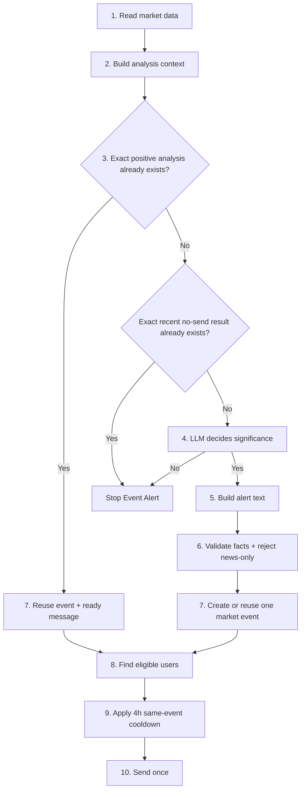

# Event Alert logic

Current flow, in simple form.



## Step 1 - Read the market
BTC, ETH, GRAM, and SOL are checked on the automatic schedule. Detection runs even when nobody is
currently eligible to receive that coin.

## Step 2 - Build the evidence
The bot prepares current price, recent snapshots, compact 30m/1h moves when reliable,
analysed-window and 24h moves, movement since the last message, 30-day relative-move context,
previous Event Alert context, recent 6h/24h alert-worthy market-event counts, and relevant news.

Numbers are evidence only. No backend numeric threshold decides whether an Event Alert is important.

## Step 3 - Reuse only exact previous work
Before new LLM calls, the bot checks whether this exact canonical context was already handled.

Two cases:
- an existing positive Event Analysis already has its event and rendered message -> reuse it and go
  straight to recipient checks;
- an exact recent context already ended with no alert / no delivery -> record the reuse and stop.

The exact-context fingerprint preserves the incoming news priority: significance
reads only the first two valid headlines. Reordering headlines therefore cannot
reuse an analysis based on a different model-visible set. Invalid non-dictionary
entries are skipped consistently by both fingerprint and significance prompt.

No rounding buckets or movement tolerances are used.

## Step 4 - Decide significance
If nothing can be reused, the significance LLM returns schema-validated `should_alert`, confidence,
`materiality`, `novelty`, and reason. Its default is no alert.

The model must judge these in order:

1. **Materiality** — is the current market move itself materially noteworthy for this asset?
2. **Novelty** — if material, is it materially new versus recent Event Alerts and recent
   alert-worthy market events?
3. **Reason** — only then classify the positive pattern.

The 24h move, news, previous alerts, and recent-event counts are context. They do not make an
otherwise routine current move material. Previous alerts and recent-event counts can reduce novelty
but cannot increase materiality. The `prev` prompt hint comes from the latest sent
Event Alert for the symbol **across recipients**, not a recipient's personal history.
It must not be interpreted as proof that every subscriber already received the prior
move; only the later per-recipient delivery check determines that. The prior
hint is ordered and aged by successful delivery time (`sent_at`), using
`created_at` only for legacy sent rows without that timestamp. A small
counter-move against a larger 24h trend is not, by itself, a meaningful reversal. Likewise, a move is not a `fast_move` merely because one short window is
faster than another; the current move itself must be materially noteworthy for the asset.

There is still no deterministic numeric threshold in the backend. Percentages and historical
percentiles are evidence for the LLM, not hard gates.

- `should_alert=true` is schema-valid only with `materiality=material` and `novelty=new`;
- otherwise the result must be `should_alert=false`;
- news-only -> false;
- contradictory field combinations are schema-invalid and do not proceed to render or delivery.

Alert reasons (`unusual_move`, `fast_move`, `reversal`, `trend_acceleration`,
`market_news_alignment`) are valid only with a positive decision. No-alert reasons
(`routine_move`, `news_only`, `unclear`) are valid only with a negative decision.

## Step 5 - Build the message
Only a new positive decision gets the render LLM call. It writes presentation text only and cannot
change the significance decision.

If supported render failures exhaust the provider chain, the backend may build neutral deterministic
presentation text from the already validated market evidence.

### Render evidence and backend guard behavior

Render receives backend-computed, non-numeric relationship labels: analysed-window
versus 24-hour direction, snapshot path, pace when verified, and comparable prior
alert. Render stays separate from significance. It runs once per positive event,
not per recipient. Situation explains a verified relationship, and Possible Action
names the next market observation that distinguishes possible outcomes.

Direction checks bind each claim to its named market period and verify that
cross-period agreement claims are true for both periods, even when only the
broader trend has an explicit up/down adjective. Negated alignment describes
divergence, and a comparison with the latest snapshot is not automatically a
comparison with the broader day. "Consistent with" expresses
alignment, not persistent snapshot motion. Persistence markers stay linked to
their described direction across punctuation; unsupported paths remain rejected.
When only 24-hour alignment supports a fallback, it names direction and compares
supplied net-move magnitudes without implying pace, novelty or materiality.

Backend guards still reject unsupported numbers, directions, trajectories,
catalysts, causation, and trading instructions. They no longer discard grounded
natural language based on an exhaustive word allowlist. Invalid presentation
fields may use an evidence-only fallback; the original render-provider exhaustion
policy remains unchanged, with no additional provider calls for recovery.

Related headlines are checked again at final assembly: only direct asset coverage
or explicitly broad crypto-market context remains. No causal claim is inferred.
An isolated keyword such as Fed, ETF, exchange or hack does not itself make a
headline broadly relevant. The since-previous-notification line names the actual
notification type and UTC timestamp, distinct from the analysed market window.

Quality checks inspect the final Telegram message, not only LLM JSON. Sanitized
event-level replacement/generic/repetition signals are diagnostic only and never
decide significance. The ops-agent aggregates distinct delivered market events,
not each recipient or provider draft. See docs/observability.md.

### Event Alert message quality contract

A mobile alert should answer three questions in this order without becoming a report:

1. **What changed?** A deterministic headline and compact metric block show the actual
   analysed-window move, current price, and movement since the prior delivered alert/message
   **only when** its reference price and timestamp are available. Never repeat these numbers
   in free-form situation prose.
2. **Why does this move matter now?** The situation adds **one verified relationship**:
   a consistent snapshot path, a counter-move within that path, divergence/alignment with the
   24-hour direction, or a faster/slower latest *observed snapshot interval* based on
   actual elapsed minutes and exactly comparable compounded rates, not nominal 30m/1h
   lookbacks. Pace comparison requires three
   valid time-ordered snapshots including a current observation, consistent signed
   consecutive moves and a matching primary-move direction, plus corroborating 30m/1h
   directional evidence and an analysed window of at least one hour. These relationships
   describe a previously accepted event; they never create or suppress an alert. If nothing
   beyond the analysed-window move is confirmed, say so instead of inventing novelty.
   A recent previous delivered Event Alert may also supply a factual comparison of the
   **same-length** analysed windows, when both moves and elapsed age are available. This
   describes relative direction or size, not significance, rarity, or proven novelty.
3. **What is worth monitoring?** Name the next observation that could distinguish continuation,
   slowing, or counter-movement. Prefer a specific supplied time frame when justified; otherwise
   use a short, neutral conditional. Never give a trading instruction or generic risk-plan advice.

Previously delivered alerts and recent-event counts help decide novelty upstream, but **do not
prove** that the delivered move is unprecedented. The since-last-message metric may establish a
verified difference in price, not a claim that the event is the first or most important.
Thirty-day historical percentiles are comparison evidence, not proof of rarity without a
sufficiently described sample and provenance; the current message contract does not present
percentile-based rarity claims. Do not add unverified volume, ETF/regulatory actions, causality,
rumours, or inference about trader intent. Related articles may be shown as coincident context
but do not become an alert reason. Shorter, missing-data-safe copy is better than padding.
Keep the existing disclaimer and single shared render per event.

## Telegram Event Alert presentation (2026-10)

The market significance decision, one shared render per event, cooldowns, eligibility and
Market Heartbeat are unchanged. The nine display positions are: coin/Event Alert and
analysed-window percent, `Price (now)`, since *recipient's last successfully delivered*
notification when comparable price and delivery time are persisted, actual analysed-window
move, available historical-price chart, Situation, attributed Related context when present,
conditional Possible action, and `Not financial advice.`

Rich Messages are supported by Telegram Bot API 10.2+ using `sendRichMessage` and
`InputRichMessage.media` for an inline PNG. The pinned `python-telegram-bot 22.8`
does not expose the rich-message API, so a small direct HTTPX adapter uses the official
endpoint. The outgoing message has one Telegram identity (not a chart message plus
caption). PNG creation reads existing timestamped PostgreSQL price snapshots once per
market event, never in the recipient loop, and caches the returned Telegram photo
`file_id` within that dispatch. No new market-data calls are made.

Only proven historical observations are plotted. Missing or stale data shows a chart
unavailable explanation; shorter valid coverage is explicitly labeled as such.
Ordinary HTML and plain text remain fallbacks after *definitive* rejection of a richer
variant. Unknown transport acceptance must not trigger a second send because Telegram
has no caller-supplied send-idempotency key. Rich-client compatibility cannot be
reliably detected server-side; clients that do not render Rich Messages may require
updating Telegram. Any rollback should revert the presentation commit(s) and retain
existing event/delivery persistence; no schema migration is introduced.

## Step 6 - Validate the message
The backend validates schema and factual market claims. News may support the explanation, but a
standalone news-only Event Alert is rejected.

## Step 7 - Keep one event and one analysis
A newly detected event is created once. A reusable positive event keeps its already existing Event
Analysis and message.

Semantic event identity cannot be classified as `news_catalyst` from model wording alone: it
requires selected material related news. If an otherwise accepted market alert uses the bare
`{symbol}_news_catalyst` key without that evidence or a clear price family, the backend gives
it the neutral `{symbol}_market_event` identity. This changes identity classification, not the
LLM's significance decision or the market-first rule.

For an explicitly directional price family, the sign of the verified analysed-window move
wins over conflicting model key/title/body wording about a broader trend. A missing or flat
primary move does not invent direction. During recipient cooldown, an older stored directional
family is interpreted using its own saved analysed-window move when available, so correcting
an identity cannot restart the same event-family's strict four-hour window. When
either the current or a prior numeric directional price key lacks a stored semantic family,
the recipient cooldown derives that price family from the key before comparing identities.

Core rule:

```text
1 coin market event = 1 AI analysis = many deliveries
```

LLM calls never run inside the recipient loop.

## Step 8 - Find eligible users
Only now the bot checks delivery eligibility:
- coin enabled in watchlist;
- BTC is free;
- ETH, GRAM, and SOL require active Premium or trial;
- valid Telegram destination;
- duplicate chat IDs filtered.

The Market Heartbeat silence window does not decide Event Alert eligibility. Successfully
delivered Event Alerts reset the heartbeat clock for that recipient and coin; see
`docs/project_context.md`.

## Step 9 - Block repeats for 4 hours
For each recipient, the same canonical event key or the same semantic family is blocked for four
hours.

No bypass exists for a bigger move, urgency, new news, or a direction change inside the same
semantic event. A genuinely different semantic event can pass.

The four-hour window starts at confirmed successful delivery (`sent_at`), with a legacy
`created_at` fallback only for stored rows missing completion timestamps. Historical
price-movement evidence may recover a missing stored price family. A second cooldown
check under the shared user-and-coin delivery lock closes the gap between bulk
pre-filtering and an actual send; it does not block distinct semantic families.

## Step 10 - Send once
Delivery is idempotent. The bot records delivered, failed, filtered, cooldown, and suppression
outcomes and avoids sending the same event twice to the same recipient.

CoinGecko values keep full precision through analysis. Rounding is only for user-facing text.


Evaluation harness, documented baseline and reviewer procedure: [event_alert_benchmark.md](event_alert_benchmark.md).

## Event Alert acceptance criteria (approved 2026-10-16)

These are **product release acceptance criteria**, not runtime significance thresholds.
They apply to work intended to improve Event Alert usefulness. They do not change
the market-first policy, LLM significance authority, the four-hour semantic
cooldown, or the shared-analysis architecture.

### Independent evidence and evaluation

- Build a frozen, versioned, privacy-safe evaluation set drawn from **real**
  BTC/ETH/GRAM/SOL market contexts, including alerts actually sent and
  situations for which the bot chose not to alert. Include marginal, repeated,
  unusual, news-present and news-absent scenarios. Target 150-200 scenarios
  initially; increase sample size when metric confidence is inadequate.
- **Two independent evaluators** assess whether each event warrants alerting
  and whether the final delivered text is informative and factual. They
  review the evidence without seeing the original bot decision. Record each
  assessment, disagreements, reconciled labels, and ambiguous cases. Report
  ambiguous cases separately rather than silently counting them as successes.
- Replay baseline and candidate logic on **the same frozen cases**, with
  versioned inputs, model/configuration, and recorded results. Record
  positive and negative decisions; counting only sent messages cannot
  establish that important events were not missed.
- Report both **event-level** and **recipient-delivery-weighted** results,
  including per-symbol breakdowns. One BTC event reaching hundreds of
  recipients must not conceal lower-quality ETH/GRAM/SOL decisions.
- User feedback may be collected **after release** as a separate product
  outcome, subject to privacy and product approval. It does not replace
  independent pre-release evaluation.

### Eight mandatory acceptance gates

1. **Relevance / no unnecessary noise:** at least **85%** of reviewed
   positive Event Alerts are judged useful on independently labelled,
   unambiguous examples. Report event-level and delivery-weighted rates.
2. **No significant misses:** detect at least **90%** of independently
   confirmed significant market events in the same evaluation set.
   Report false negatives, not just overall alert volume.
3. **Useful explanation:** at least **90%** of reviewed final Telegram
   alert messages explain a verified relationship or useful next market
   observation beyond repeating the price delta. Evaluate the **final
   delivered text**, including any backend fallback/replacement.
4. **Factual correctness:** **zero detected factual errors** in the
   inspected final-message sample. Unsupported catalysts, invented
   trajectory, false direction/period comparisons and fabricated numeric
   claims are failures. This is a sample-based gate, not a claim of
   absolute error-free behavior in all future messages.
5. **No same-event spam:** **zero verified violations** of the existing
   four-hour per-recipient same-key/same-semantic-family cooldown.
   Different genuine semantic events for the same coin may pass;
   changes of event key or wording must not bypass the same-family
   suppression.
6. **Technical reliability:** mandatory repository tests, regression
   cases and relevant integration checks pass; no newly introduced
   systemic analysis, deduplication or delivery failures. External
   failures (e.g. users blocking the Telegram bot) are measured and
   reported **separately**, not misclassified as application faults.
7. **Measured net improvement:** against the frozen baseline, reduce
   low-value alerts and improve explanatory quality **without increasing
   misses of important events**. The relevance and recall gates must
   both hold; suppressing nearly all alerts does not count as success.
8. **No cost increase:** **no increase in monetary operating costs**
   relative to the current version on equivalent market-monitoring
   workloads. Include LLM/provider usage and all added external
   dependencies in the comparison. No new paid service is allowed.
   Preserve one shared Event Analysis and at most one render per
   qualifying market event, never per recipient. Also report token,
   provider-call and rate-limit pressure even where nominal spend is zero.

### Execution and release gates

Implement in independently reviewable stages, based on confirmed evidence:

1. **Diagnose and freeze baseline:** trace market evidence -> analysis ->
   render -> guards -> event identity -> recipient cooldown -> delivery;
   identify confirmed root causes; add historic regression cases.
2. **Build the evaluation harness:** capture sanitized, labelled real
   events including suppressed decisions; reproduce current baseline.
3. **Fix significance and duplication:** compare candidate prompts/model
   settings and context/reuse changes against the same frozen set.
   Preserve LLM significance authority; do **not** add deterministic
   numeric decision thresholds.
4. **Fix final-message utility:** investigate render replacement and
   generic fallbacks; improve grounded Situation / Possible Action while
   preserving fact checks and safety.
5. **Run end-to-end acceptance checks:** compare all eight gates,
   regression tests, integration behavior, and operating cost before
   declaring the candidate ready.
6. **Release separately:** only after explicit approval and the
   repository release process; assess real post-release outcomes and
   retain a safe rollback path.

A failed gate blocks claiming completion. If evidence is insufficient,
report the gap and do not present the target as achieved. Production
changes, Premium, watchlists, payments and Market Heartbeat remain out
of scope unless separately approved.
