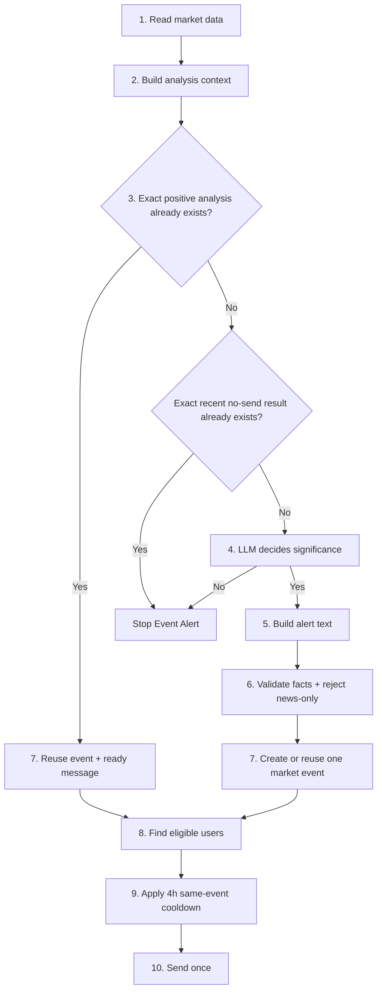

# Event Alert logic

Current flow, in simple form.



## Step 1 - Read the market
BTC, ETH, GRAM, and SOL are checked on the automatic schedule. Detection runs even when nobody is
currently eligible to receive that coin.

## Step 2 - Build the evidence
The bot prepares current price, recent snapshots, compact 30m/1h moves when reliable,
analysed-window and 24h moves, movement since the last message, 30-day relative-move context,
previous Event Alert context, recent 6h/24h alert-worthy market-event counts, and relevant news.

Numbers are evidence only. No backend numeric threshold decides whether an Event Alert is important.

## Step 3 - Reuse only exact previous work
Before new LLM calls, the bot checks whether this exact canonical context was already handled.

Two cases:
- an existing positive Event Analysis already has its event and rendered message -> reuse it and go
  straight to recipient checks;
- an exact recent context already ended with no alert / no delivery -> record the reuse and stop.

No rounding buckets or movement tolerances are used.

## Step 4 - Decide significance
If nothing can be reused, the significance LLM returns schema-validated `should_alert`, confidence,
`materiality`, `novelty`, and reason. Its default is no alert.

The model must judge these in order:

1. **Materiality** — is the current market move itself materially noteworthy for this asset?
2. **Novelty** — if material, is it materially new versus recent Event Alerts and recent
   alert-worthy market events?
3. **Reason** — only then classify the positive pattern.

The 24h move, news, previous alerts, and recent-event counts are context. They do not make an
otherwise routine current move material. Previous alerts and recent-event counts can reduce novelty
but cannot increase materiality. A small counter-move against a larger 24h trend is not, by itself,
a meaningful reversal. Likewise, a move is not a `fast_move` merely because one short window is
faster than another; the current move itself must be materially noteworthy for the asset.

There is still no deterministic numeric threshold in the backend. Percentages and historical
percentiles are evidence for the LLM, not hard gates.

- `should_alert=true` is schema-valid only with `materiality=material` and `novelty=new`;
- otherwise the result must be `should_alert=false`;
- news-only -> false;
- contradictory field combinations are schema-invalid and do not proceed to render or delivery.

Alert reasons (`unusual_move`, `fast_move`, `reversal`, `trend_acceleration`,
`market_news_alignment`) are valid only with a positive decision. No-alert reasons
(`routine_move`, `news_only`, `unclear`) are valid only with a negative decision.

## Step 5 - Build the message
Only a new positive decision gets the render LLM call. It writes presentation text only and cannot
change the significance decision.

If supported render failures exhaust the provider chain, the backend may build neutral deterministic
presentation text from the already validated market evidence.

### Render evidence and backend guard behavior

Render receives backend-computed, non-numeric relationship labels: analysed-window
versus 24-hour direction, snapshot path, pace when verified, and comparable prior
alert. Render stays separate from significance. It runs once per positive event,
not per recipient. Situation explains a verified relationship, and Possible Action
names the next market observation that distinguishes possible outcomes.

Backend guards still reject unsupported numbers, directions, trajectories,
catalysts, causation, and trading instructions. They no longer discard grounded
natural language based on an exhaustive word allowlist. Invalid presentation
fields may use an evidence-only fallback; the original render-provider exhaustion
policy remains unchanged, with no additional provider calls for recovery.

Related headlines are checked again at final assembly: only direct asset coverage
or explicitly broad crypto-market context remains. No causal claim is inferred.
An isolated keyword such as Fed, ETF, exchange or hack does not itself make a
headline broadly relevant. The since-previous-notification line names the actual
notification type and UTC timestamp, distinct from the analysed market window.

Quality checks inspect the final Telegram message, not only LLM JSON. Sanitized
event-level replacement/generic/repetition signals are diagnostic only and never
decide significance. The ops-agent aggregates distinct delivered market events,
not each recipient or provider draft. See docs/observability.md.

### Event Alert message quality contract

A mobile alert should answer three questions in this order without becoming a report:

1. **What changed?** A deterministic headline and compact metric block show the actual
   analysed-window move, current price, and movement since the prior delivered alert/message
   **only when** its reference price and timestamp are available. Never repeat these numbers
   in free-form situation prose.
2. **Why does this move matter now?** The situation adds **one verified relationship**:
   a consistent snapshot path, a counter-move within that path, divergence/alignment with the
   24-hour direction, or a faster/slower latest *observed snapshot interval* based on
   actual elapsed minutes and exactly comparable compounded rates, not nominal 30m/1h
   lookbacks. Pace comparison requires three
   valid time-ordered snapshots including a current observation, consistent signed
   consecutive moves and a matching primary-move direction, plus corroborating 30m/1h
   directional evidence and an analysed window of at least one hour. These relationships
   describe a previously accepted event; they never create or suppress an alert. If nothing
   beyond the analysed-window move is confirmed, say so instead of inventing novelty.
   A recent previous delivered Event Alert may also supply a factual comparison of the
   **same-length** analysed windows, when both moves and elapsed age are available. This
   describes relative direction or size, not significance, rarity, or proven novelty.
3. **What is worth monitoring?** Name the next observation that could distinguish continuation,
   slowing, or counter-movement. Prefer a specific supplied time frame when justified; otherwise
   use a short, neutral conditional. Never give a trading instruction or generic risk-plan advice.

Previously delivered alerts and recent-event counts help decide novelty upstream, but **do not
prove** that the delivered move is unprecedented. The since-last-message metric may establish a
verified difference in price, not a claim that the event is the first or most important.
Thirty-day historical percentiles are comparison evidence, not proof of rarity without a
sufficiently described sample and provenance; the current message contract does not present
percentile-based rarity claims. Do not add unverified volume, ETF/regulatory actions, causality,
rumours, or inference about trader intent. Related articles may be shown as coincident context
but do not become an alert reason. Shorter, missing-data-safe copy is better than padding.
Keep the existing disclaimer and single shared render per event.

## Step 6 - Validate the message
The backend validates schema and factual market claims. News may support the explanation, but a
standalone news-only Event Alert is rejected.

## Step 7 - Keep one event and one analysis
A newly detected event is created once. A reusable positive event keeps its already existing Event
Analysis and message.

Semantic event identity cannot be classified as `news_catalyst` from model wording alone: it
requires selected material related news. If an otherwise accepted market alert uses the bare
`{symbol}_news_catalyst` key without that evidence or a clear price family, the backend gives
it the neutral `{symbol}_market_event` identity. This changes identity classification, not the
LLM's significance decision or the market-first rule.

For an explicitly directional price family, the sign of the verified analysed-window move
wins over conflicting model key/title/body wording about a broader trend. A missing or flat
primary move does not invent direction. During recipient cooldown, an older stored directional
family is interpreted using its own saved analysed-window move when available, so correcting
an identity cannot restart the same event-family's strict four-hour window. When
either the current or a prior numeric directional price key lacks a stored semantic family,
the recipient cooldown derives that price family from the key before comparing identities.

Core rule:

```text
1 coin market event = 1 AI analysis = many deliveries
```

LLM calls never run inside the recipient loop.

## Step 8 - Find eligible users
Only now the bot checks delivery eligibility:
- coin enabled in watchlist;
- BTC is free;
- ETH, GRAM, and SOL require active Premium or trial;
- valid Telegram destination;
- duplicate chat IDs filtered.

The Market Heartbeat silence window does not decide Event Alert eligibility. Successfully
delivered Event Alerts reset the heartbeat clock for that recipient and coin; see
`docs/project_context.md`.

## Step 9 - Block repeats for 4 hours
For each recipient, the same canonical event key or the same semantic family is blocked for four
hours.

No bypass exists for a bigger move, urgency, new news, or a direction change inside the same
semantic event. A genuinely different semantic event can pass.

## Step 10 - Send once
Delivery is idempotent. The bot records delivered, failed, filtered, cooldown, and suppression
outcomes and avoids sending the same event twice to the same recipient.

CoinGecko values keep full precision through analysis. Rounding is only for user-facing text.
